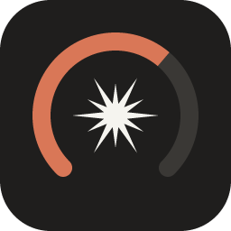
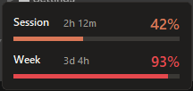
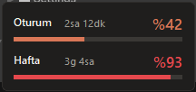

# Claude Usage Widget

A tiny always-on-top desktop widget that shows your **real** Claude usage limits — the 5-hour session and the weekly limit — exactly as they appear on claude.ai › Settings › Usage. Works on **Windows, macOS and Linux**. Single Python file, no dependencies.



[Türkçe açıklama aşağıda ↓](#türkçe)

## How it works

The widget asks the same endpoint that Claude Code's `/usage` command uses, signed in with the login Claude Code has already saved on your computer:

- **Windows / Linux:** `~/.claude/.credentials.json`
- **macOS:** the Keychain item `Claude Code-credentials`

It shows no estimates and needs no calibration. It refreshes every 60 seconds. Your token is sent only to `api.anthropic.com`.

## Install

You need [Claude Code](https://claude.com/claude-code), logged in with a Claude subscription (Pro / Max). Open it once, and the widget can use its login. Nothing else is needed.

Download from the **[latest release](https://github.com/pholsen/claude-usage-widget/releases/latest)**:

- **Windows:** `ClaudeUsage-Setup-….exe`. Run it and click through. It adds Claude Usage to the Start menu, can add a desktop shortcut and start with Windows, and you can uninstall it from Settings › Apps.
- **macOS:** `…-macOS-AppleSilicon.dmg` for M1/M2/M3/M4 Macs, `…-macOS-Intel.dmg` for older Macs. Open it and drag **Claude Usage** onto **Applications**.

The app is not code-signed yet, so the first launch shows a warning:

- **Windows** ("Windows protected your PC"): click **More info** › **Run anyway**.
- **macOS** ("Apple could not verify…"): click **Done**, then open System Settings › Privacy & Security, scroll down and click **Open Anyway** next to Claude Usage. On older macOS versions you can instead right-click the app › Open.
- **macOS Keychain:** the first refresh asks whether the app may read `Claude Code-credentials`. Choose **Always Allow**, otherwise it asks again on every refresh.

**Start automatically on macOS:** System Settings › General › Login Items › add Claude Usage.

## Run from source

For developers who prefer to run the Python file directly.

- Python 3.9+ with Tkinter
  - **Windows:** the python.org installer includes Tkinter.
  - **macOS:** use the [python.org installer](https://www.python.org/downloads/macos/) or `brew install python-tk`. Apple's `/usr/bin/python3` comes with an outdated Tk that may draw a blank window.
  - **Linux:** `sudo apt install python3-tk` (or your distro's equivalent).

**Windows:** double-click `Install (Windows).bat` once. It creates a **Claude Usage** shortcut with the widget icon on your Desktop and in the Start menu, and asks whether to start the widget with Windows. After that, open the widget from the shortcut. (Windows shows every `.pyw` file with the Python icon, so the icon only appears on the shortcut.) You can also just double-click `claude_usage_widget.pyw`; no console window opens.

**macOS:** double-click `Claude Usage.app`. The first time, macOS asks whether `security` may read the `Claude Code-credentials` Keychain item. Choose **Always Allow**, otherwise it asks again on every refresh. The app is unsigned, so if macOS says it can't be opened, right-click it › Open, or run:

```sh
xattr -dr com.apple.quarantine "Claude Usage.app"
```

Keep `Claude Usage.app` in the same folder as `claude_usage_widget.pyw`; it starts the widget from there. To keep it at hand, drag it to the Dock instead of moving it to Applications.

**Linux:** `python3 claude_usage_widget.pyw &`

To start the source version automatically on Windows, run `Install (Windows).bat` and answer **Y**.

### Building the installers

`.github/workflows/release.yml` builds them with PyInstaller (`claude_usage.spec`) and Inno Setup (`installer/windows.iss`). Push a tag such as `v1.0.1` to publish a new release. To regenerate the icons, run `python assets/make_icon.py`.

## Controls

| Action | Windows / Linux | macOS |
|---|---|---|
| Move | drag with left click | drag |
| Refresh now | double click | double click |
| Close | right click | right click or ctrl + click |

A red dot in the top-right corner means the last refresh failed and the numbers shown are stale.

The language (English / Turkish) follows your system. To set it yourself, use `CLAUDE_WIDGET_LANG=en` or `CLAUDE_WIDGET_LANG=tr`.

## Notes

- The usage endpoint is undocumented and used by Claude Code internally, so it may change without notice.
- If you poll very often (or run several copies), the API may answer `429`. The widget keeps showing the last value with a red dot and tries again later.
- This is an unofficial community tool and is not affiliated with Anthropic.

---

## Türkçe

claude.ai › Ayarlar › Kullanım sayfasındaki **gerçek** oturum (5 saatlik) ve haftalık limit yüzdelerini gösteren, her zaman üstte duran küçük bir masaüstü widget'ı. **Windows, macOS ve Linux**'ta çalışır. Tek Python dosyası, ek paket gerekmez.



**Nasıl çalışır:** Claude Code'un `/usage` komutunun kullandığı uç noktayı, Claude Code'un bilgisayarına kaydettiği girişle sorgular (Windows/Linux: `~/.claude/.credentials.json`, macOS: Anahtar Zinciri'ndeki `Claude Code-credentials` kaydı). Tahmin yapmaz, 60 saniyede bir yenilenir. Anahtarın yalnızca `api.anthropic.com`'a gönderilir.

**Kurulum:** Claude aboneliğiyle (Pro / Max) giriş yapılmış [Claude Code](https://claude.com/claude-code) yeterli; bir kez açman yeter, başka bir şey gerekmez. **[Son sürümden](https://github.com/pholsen/claude-usage-widget/releases/latest)** indir:

- **Windows:** `ClaudeUsage-Setup-….exe` dosyasını çalıştır ve İleri ile ilerle. Başlat menüsüne ekler; istersen masaüstü kısayolu ekler ve Windows açılışında başlatır. Ayarlar › Uygulamalar'dan kaldırılabilir.
- **macOS:** M1/M2/M3/M4 Mac'ler için `…-macOS-AppleSilicon.dmg`, eski Mac'ler için `…-macOS-Intel.dmg`. Aç ve **Claude Usage**'ı **Applications** (Uygulamalar) klasörüne sürükle.

Uygulama henüz imzalı olmadığı için ilk açılışta uyarı çıkar:

- **Windows** ("Windows bilgisayarınızı korudu"): **Ek bilgi** › **Yine de çalıştır**.
- **macOS** ("Apple doğrulayamadı…"): **Bitti**'ye bas, sonra Sistem Ayarları › Gizlilik ve Güvenlik'te aşağı kaydırıp Claude Usage'ın yanındaki **Yine de Aç**'a tıkla. Eski macOS sürümlerinde uygulamaya sağ tık › Aç da olur.
- **macOS Anahtar Zinciri:** İlk yenilemede `Claude Code-credentials` iznini sorar; **Her Zaman İzin Ver**'i seç.

**macOS'ta açılışta başlatmak için:** Sistem Ayarları › Genel › Giriş Öğeleri › Claude Usage'ı ekle.

**Kaynak koddan çalıştırma** (geliştiriciler için): Tkinter içeren Python 3.9+ gerekir. macOS'ta python.org kurulumunu ya da `brew install python-tk` kullan.
- **Windows:** `Install (Windows).bat` dosyasına bir kez çift tıkla. Masaüstüne ve Başlat menüsüne ikonlu **Claude Usage** kısayolu ekler, Windows açılışında başlasın mı diye sorar. Sonra widget'ı bu kısayoldan aç. (Windows her `.pyw` dosyasını Python ikonuyla gösterir; ikon yalnızca kısayolda görünür.)
- **macOS:** `Claude Usage.app` uygulamasına çift tıkla. İlk açılışta Anahtar Zinciri izni sorulur; **Her Zaman İzin Ver**'i seç, yoksa her yenilemede tekrar sorar. Uygulama imzasız olduğu için açılmazsa sağ tık › Aç ile aç. Uygulamayı `claude_usage_widget.pyw` ile aynı klasörde tut; el altında olsun istersen Uygulamalar'a taşımak yerine Dock'a sürükle.
- **Linux:** `python3 claude_usage_widget.pyw &`

**Kullanım:**
- Taşımak için sol tıkla sürükle.
- Hemen yenilemek için çift tıkla.
- Kapatmak için sağ tıkla (Mac'te ctrl + tık da olur).

Sağ üstteki kırmızı nokta, son yenilemenin başarısız olduğunu ve gösterilen değerin eski olduğunu belirtir.

Dil sisteme göre seçilir. Kendin seçmek için `CLAUDE_WIDGET_LANG=tr` ya da `CLAUDE_WIDGET_LANG=en` kullan.

Resmi olmayan bir topluluk aracıdır, Anthropic ile bağlantısı yoktur. Kullandığı uç nokta belgelenmemiştir ve haber verilmeden değişebilir.

## License

MIT
